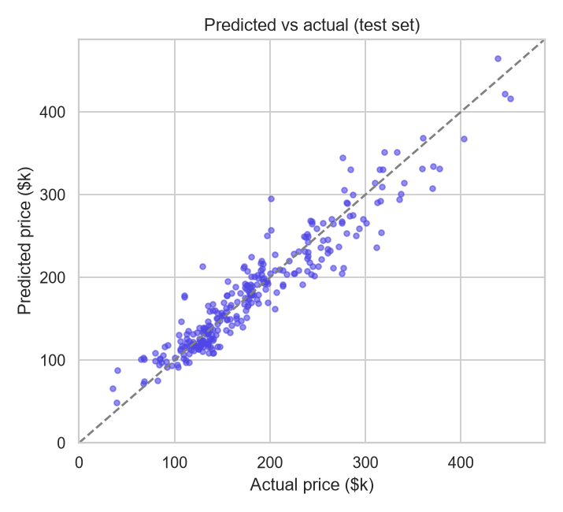

# House Price Estimator

Estimates the sale price of a house in Ames, Iowa from 13 facts a buyer or agent already knows: size, quality, age, garage and neighborhood.

**[Live demo →](https://ravshanovna-house-prices.vercel.app)** — fill in a house profile and get a price estimate instantly. The model runs in your browser (ONNX Runtime Web), no server needed.



## Results

Held-out test set (20%, 292 houses):

| Metric | Score |
|---|---|
| RMSE | **$23,453** |
| MAE | $17,231 |
| R² | 0.900 |
| RMSE (log price) | 0.143 |
| Median relative error | 7.7% |

5-fold cross-validation on the training set (target = log1p(price), 13 features):

| Model | CV RMSE (log) | CV R² |
|---|---|---|
| **Ridge** (chosen) | 0.132 | 0.888 |
| Gradient Boosting | 0.134 | 0.884 |
| HistGradientBoosting | 0.138 | 0.878 |
| Random Forest | 0.140 | 0.875 |

On ~1,150 training homes a well-regularised linear model on log price beats the tree ensembles, and it is the simplest to explain, so it is the final model. Using all 79 original features would lower the CV RMSE (log) from 0.133 to 0.113 (see the notebook) — I traded that for a short form anyone can fill in.

## Key findings

- **Living area** and **overall quality** are by far the strongest drivers of price.
- **Location matters**: the median price ranges from ~$88k (Meadow Village) to ~$315k (Northridge Heights) — more than 3.5×.
- Newer or recently remodelled houses sell for more; fair kitchen/exterior quality and no central air each lower the estimate by roughly 6–8%.

## Approach

1. **Data** — Kaggle's House Prices `train.csv`, loaded from its exact copy on OpenML (no login needed). 2 documented outliers (>4,000 sq ft partial sales) removed.
2. **Target** — `log1p(SalePrice)`: the price is right-skewed, and errors on the log scale are relative.
3. **Features** — 13 understandable features (9 numeric, 4 categorical); neighborhood and quality codes mapped to readable words.
4. **Pipeline** — `ColumnTransformer` (scaling + one-hot encoding) and the model in one scikit-learn `Pipeline`.
5. **Model selection** — 5-fold CV comparing Ridge, Random Forest, Gradient Boosting and HistGradientBoosting; final single check on an untouched test set.
6. **Explainability** — permutation importance and Ridge coefficients.
7. **Deployment** — the full pipeline is exported to ONNX, verified against scikit-learn, and the browser converts the log prediction back to dollars.

## Project structure

```
├── notebook.ipynb     # EDA, feature selection, model comparison, evaluation (with outputs)
├── train.py           # reproducible training + ONNX export
├── export_utils.py    # ONNX export / verification helpers
├── requirements.txt
└── web/               # static demo deployed on Vercel
    ├── index.html, app.js, style.css
    ├── model.onnx     # exported pipeline
    ├── meta.json      # form schema, metrics, comparison
    └── assets/        # charts
```

## Run locally

```bash
pip install -r requirements.txt
python train.py                         # downloads data, trains, writes web/model.onnx
python -m http.server 8000 -d web       # open http://localhost:8000
```

## Tech

Python · pandas · scikit-learn · matplotlib/seaborn · skl2onnx · ONNX Runtime Web · Vercel

**Dataset:** [Ames House Prices](https://www.openml.org/d/42165) (1,460 homes, 79 features; same as Kaggle's [House Prices competition](https://www.kaggle.com/competitions/house-prices-advanced-regression-techniques) training set).
